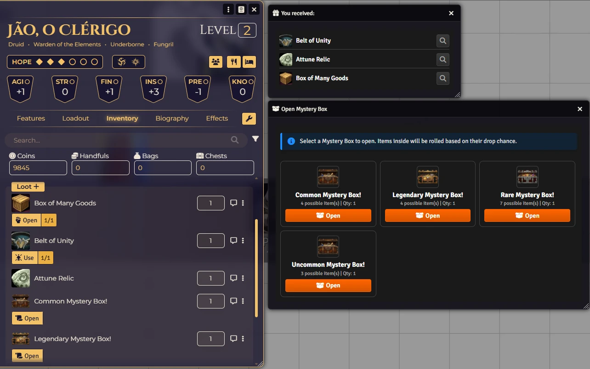
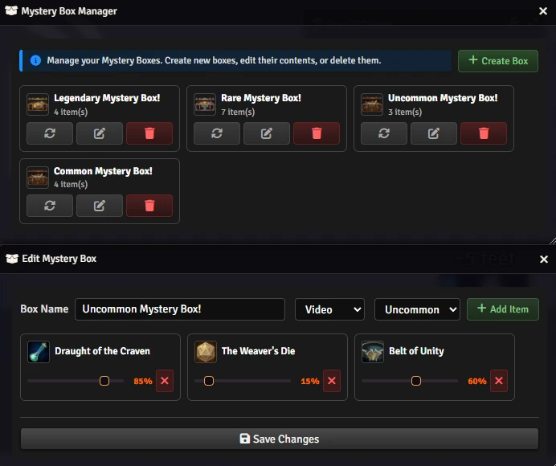
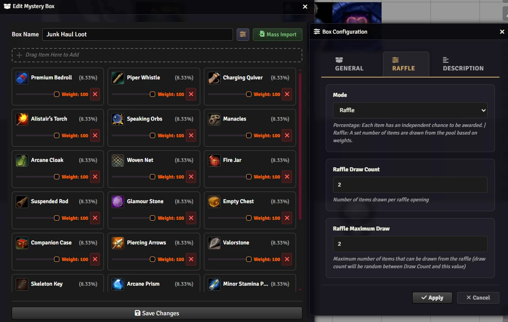
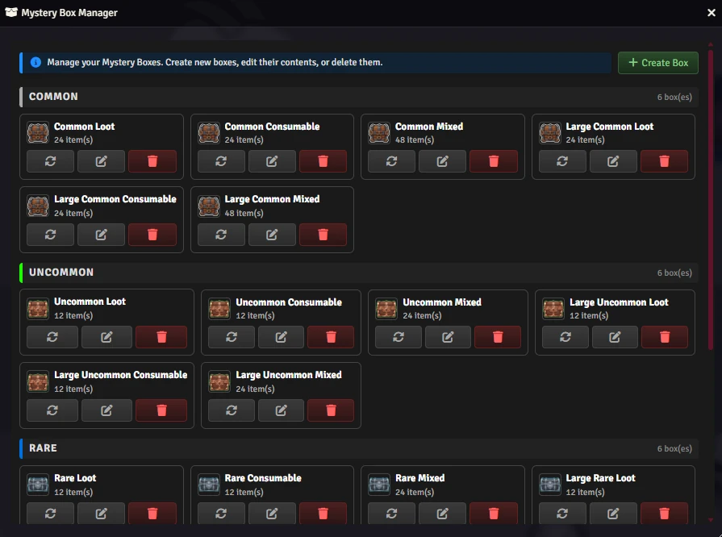

# 🎁 Mystery Box

## for Daggerheart

Mystery Box lets the GM hand out loot as a box instead of a list. The player clicks the box on their character sheet and opens it, the module rolls for what is inside, a confetti burst, sound or video plays, and the items they won go straight into their inventory.

The GM decides what each box holds, the chance of each item, and whether the box can come out empty or always gives a set number of items.

<p align="center">
  
</p>

[](https://buymeacoffee.com/mestredigital) [](https://mestredigital.online/pages/projetos-en)

Players like the wait before the result, and the GM no longer has to move items into each sheet by hand. Boxes can be exported and shared between worlds.

## How to use it

1. Open the Mystery Box Manager with **Manage Mystery Boxes** in the Daggerheart Menu, or with the `MysteryBox.Manager()` macro. Create a box and give it a name, a rarity, an opening style and a mode.
2. Drag items into the box. In **Percentage** mode you set each item's own drop chance. In **Raffle** mode you set a weight for each item and how many items the player receives.
3. Drag the box onto a player's character sheet, or take one from the premade compendium.
4. The player clicks the box on their sheet and then **Open**. The reveal plays, the items go into their inventory, and a message is posted in the chat.

The Manager is the GM's control panel. There you create boxes, name them, set their rarity, choose the opening style (Confetti, Video, Sound Only or None) and the mode (Percentage or Raffle). Once configured, the box is ready to be filled with items.

<p align="center">
  
</p>

## Box modes

When you create a box, you choose how it decides what the player receives.

### Percentage mode

Each item in the box has its own chance of being given to the player.

When the player opens the box, the module rolls 1d100 for each item separately:
- If the roll is equal to or lower than the item's chance, the player receives that item.
- If not, that item is skipped.

So the player can receive several items at once, just one, or nothing, depending on the rolls.

> For example, a box contains three items:
> - Rare Sword, 10% chance
> - Healing Potion, 80% chance
> - Magic Scroll, 50% chance
>
> Each one is rolled on its own. The player could walk away with all three, only the Potion, or nothing at all.

Items set to 100% are always given, with no roll.

### Raffle mode

The box draws a fixed number of items from the pool, like a raffle. The player always receives exactly that number of items, or a number within the range the GM set.

Instead of each item rolling against its own chance, all items compete in one weighted draw:
- Items with higher weights are more likely to be picked.
- Items with lower weights are rarer picks.
- The same item cannot be drawn twice in one opening.

A visible 1d100 is rolled first, and its result seeds the random number generator. Then the weighted draw happens.

> For example, a box has 5 items, each with a different weight, and is set to draw 2 items. The player always gets exactly 2, but which 2 depends on the weights and the draw.

Use this mode when you want a fixed number of rewards but still want chance to decide which ones.

In Raffle mode the box lists each item with its weight instead of a percentage, and the GM sets how many items each opening gives.

<p align="center">
  
</p>

### Quick comparison

| | Percentage | Raffle |
|---|---|---|
| Items received | 0 to all | Fixed count (N) |
| Each item rolled? | Yes, independently | No, all compete together |
| Can get nothing? | Yes | No (unless pool is empty) |
| Best for | Loot drops with variable results | Prize boxes with guaranteed rewards |

## Opening styles

Each box has an opening style, which decides how the reveal looks to the player.

### Confetti
A burst of confetti fills the screen while the rarity sound plays.

### Video
Plays the video you chose for the box's rarity in **Default Assets**, then shows the items. The module does not include any videos. If no video is set for that rarity, nothing plays, not even the sound.

### Sound Only
Plays the rarity sound with no animation, so the reveal does not interrupt play.

### None
No animation and no sound. The items are shown right away.

> Video suits a big reward, Confetti an everyday box, Sound Only a moment where you want the sound without anything on screen, and None a fast reveal.

## Party loot

Under **Game Settings**, **Party Actor** lets you pick a shared actor for the group. Once it is set, the Open window shows a **Send loot to party** switch. With it on, the items go to the party actor instead of the player's character, the chat message is public, and the opening effect plays for every player.

All players must be **Owner** of that actor, or they cannot add items to it.

## Settings

- **Chat Message Visibility** decides who sees the message when a box is opened: everyone, or only the GM as a whisper (the default).
- **Default Assets** has four tabs: the icon for each rarity, the opening video for each rarity, the sound for each rarity plus the sound for an empty box, and the opening style and mode that new boxes start with.
- **Debug Logs** prints each roll to the console: the item, its chance and the result.

## Premade boxes, export and import

The module comes with a compendium of ready-to-use Mystery Boxes in several rarities and themes. You can drag one straight onto a character sheet, or use it as a starting point for your own boxes.

<p align="center">
  
</p>

You can also share the boxes you create with other worlds. When you import a Mystery Box item into a world, the module sets up the box's settings for you.

## Macros

```js
MysteryBox.Open();
```

```js
MysteryBox.Manager();
```

### Developers
[API](https://github.com/brunocalado/dh-mystery-box/wiki/API)

## Compatibility

- System: Daggerheart.
- Dice So Nice! (optional): shows 3D dice for the box's opening rolls.
- Unidentified (optional): items that Unidentified has masked keep their masked name and icon when they come out of a Mystery Box, in the reveal window and in the chat message. The player only sees the real item after identifying it through Unidentified. GMs always see the real item, as everywhere else in Unidentified.
- Nice Sheets (optional): on a character using that sheet, each box gets a ring and a tag in its rarity color, and the Open and reveal windows switch to the sheet's gold-on-dark style.

## Installation

Install it from the Foundry VTT module browser, or use this manifest link:

```
https://github.com/brunocalado/dh-mystery-box/releases/latest/download/module.json
```

It needs Foundry VTT v14 and the Daggerheart system 2.2.6 or later.

## ⚖️ Credits & License

* **Code License:** GNU GPLv3.

* **Icons:** Default rarity icons are Foundry VTT's own bundled core icons — no custom art ships with this module.

* **empty.mp3, box-common.mp3, box-uncommon.mp3, box-rare.mp3, box-legendary.mp3:** [License](https://pixabay.com/service/license-summary/)

**Disclaimer:** This module is an independent creation and is not affiliated with Darrington Press.

# 🧰 My Daggerheart Modules

| Module | Description |
| :--- | :--- |
| 💀 [**Adversary Manager**](https://github.com/brunocalado/daggerheart-advmanager) | Scale adversaries instantly and build balanced encounters. |
| 🖼️ [**Art Mapper**](https://github.com/brunocalado/dh-assets) | Automatically assigns artwork to system compendiums, actors, tokens, and custom module content — keeping your visuals organized and up to date. |
| 🐉 [**Colossus**](https://github.com/brunocalado/dh-colossus) | Manage massive multi-part boss encounters with independent HP per part and a single shared stress pool. |
| 📦 [**Containers**](https://github.com/brunocalado/dh-containers) | Group inventory items into collapsible containers — pouches, chests, backpacks — to declutter character sheets. |
| 💥 [**Critical**](https://github.com/brunocalado/daggerheart-critical) | Animated criticals. |
| 💠 [**Custom Stat Tracker**](https://github.com/brunocalado/dh-new-stat-tracker) | Add custom trackers to actors. |
| ☠️ [**Death Moves**](https://github.com/brunocalado/daggerheart-death-moves) | Enhances the Death Move moment with a dramatic interface and full automation. |
| 📏 [**Distances**](https://github.com/brunocalado/daggerheart-distances) | Visualizes combat ranges with customizable rings and hover calculations. |
| 📦 [**Extra Content**](https://github.com/brunocalado/daggerheart-extra-content) | Homebrew content pack. |
| 😱 [**Fear Tracker**](https://github.com/brunocalado/daggerheart-fear-tracker) | Adds an animated slider bar with configurable fear tokens to the UI. |
| 🧟 [**Horde**](https://github.com/brunocalado/dh-horde) | Explode single horde tokens into dozens of individual tokens and manage their movement and stats automatically. |
| 🎁 [**Mystery Box**](https://github.com/brunocalado/dh-mystery-box) | Introduces mystery box mechanics for random loot and surprises. |
| 📝 [**Nice Sheets**](https://github.com/brunocalado/dh-nice-sheets) | An alternative character sheet with a resource sidebar, ranked trait plaques, and the character's art filling the background. |
| ⚡ [**Quick Actions**](https://github.com/brunocalado/daggerheart-quickactions) | Quick access to common mechanics like Falling Damage, Downtime, etc. |
| 📜 [**Quick Rules**](https://github.com/brunocalado/daggerheart-quickrules) | Fast and accessible reference guide for the core rules. |
| 🤖 [**Resource Macros**](https://github.com/brunocalado/daggerheart-fear-macros) | Automatically executes macros when the Fear, Hope, Stress, HP, or Armor resources change. |
| 🎲 [**Stats**](https://github.com/brunocalado/daggerheart-stats) | Tracks dice rolls from GM and Players. |
| 🧠 [**Stats Toolbox**](https://github.com/brunocalado/dh-statblock-importer) | Import actors using a statblock. |
| 🛒 [**Store**](https://github.com/brunocalado/daggerheart-store) | A dynamic, interactive, and fully configurable in-game store. |
| 🔍 [**Unidentified**](https://github.com/brunocalado/dh-unidentified) | Obfuscates item names and descriptions until they are identified by the players. |
| 🌌 [**Void**](https://github.com/brunocalado/the-void-unofficial) | Unofficial module that brings The Void playtesting content — experimental classes, subclasses, ancestries, communities, adversaries, loot, weapons, and more. |

# 🗺️ Adventures

| Adventure | Description |
| :--- | :--- |
| ✨ [**I Wish**](https://github.com/brunocalado/i-wish-daggerheart-adventure) | A wealthy merchant is cursed; one final expedition may be the only hope. |
| 💣 [**Suicide Squad**](https://github.com/brunocalado/suicide-squad-daggerheart-adventure) | Criminals forced to serve a ruthless master in a land on the brink of war. |
